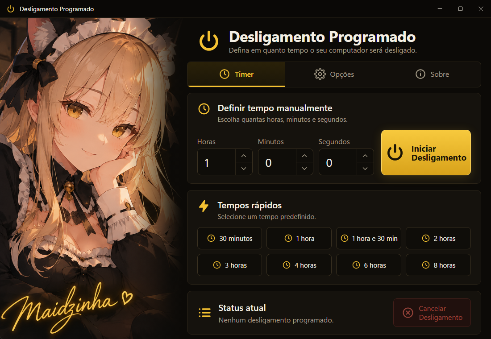

<div align="center">

# Desligamento Programado ♡

**Desligue o PC na hora certa.**

Defina um tempo e o computador desliga, reinicia, suspende, hiberna ou sai da conta sozinho. Um app simples, com visual preto e dourado, em português (Brasil).

[](https://github.com/Maidzinha/desligamento-programado/releases/latest)


[](LICENSE)



</div>

## Baixar

Vá em **[Releases → última versão](https://github.com/Maidzinha/desligamento-programado/releases/latest)** e baixe o **`Desligamento-Programado.exe`**.

É um arquivo portátil: não instala nada, basta dar dois cliques. Ele já traz tudo o que precisa dentro.

**Requisitos:** Windows 10 ou Windows 11, 64 bits.

> **"O Windows protegeu o computador"?** Esse aviso do SmartScreen aparece porque o app não tem assinatura digital comercial.
> Clique em **Mais informações → Executar assim mesmo**. Para conferir o download, compare o SHA-256 do arquivo com o `SHA256SUMS.txt` da release.

## Como usar

1. Abra o **Desligamento Programado**.
2. Na aba **Timer**, digite horas, minutos e segundos e clique em **Iniciar Desligamento**. Ou use um dos **tempos rápidos** (30 minutos até 8 horas).
3. Acompanhe a contagem em **Status atual**. Para desistir, clique em **Cancelar Desligamento**.
4. Em **Opções**, escolha o que acontece no fim do tempo e ajuste o comportamento do app.

## O que ele faz

- **Cinco ações:** desligar, reiniciar, suspender, hibernar ou sair da conta.
- **Timer manual e tempos rápidos:** 30 minutos, 1 h, 1 h 30, 2 h, 3 h, 4 h, 6 h e 8 h.
- **Agendamento nativo do Windows:** para desligar e reiniciar, o app usa o `shutdown` do Windows, então o desligamento acontece mesmo se você fechar o programa. Cancelar no app cancela também no Windows.
- **Aviso 1 minuto antes:** uma notificação quando faltar 1 minuto.
- **Forçar fechamento dos programas:** opcional, e pode perder dados não salvos.
- **Iniciar com o Windows, bandeja e sempre no topo:** opcionais, em **Opções**.

> Suspender, hibernar e sair da conta só acontecem enquanto o app estiver aberto (ou na bandeja, se você ativar **Minimizar para a bandeja**).

## Segurança

- **Desde a versão 1.0.1:** um desligamento programado que já passou nunca é repetido ao abrir o app. Quem usa a 1.0.0 deve atualizar.
- O app só executa comandos do próprio Windows (`shutdown` e suspensão), nada de fora.
- Não acessa a internet, não guarda senhas e não coleta dados.
- A configuração fica só no seu PC, em `%APPDATA%\desligamento-programado\config.json`.

## Licença

O Desligamento Programado é **proprietário**, sob uma [licença de uso privado](LICENSE). Todos os direitos são reservados.

- ✅ **Pode:** baixar daqui, usar de graça, em quantos PCs quiser, e indicar o link oficial.
- ❌ **Não pode:**
  - modificar o app ou criar versões derivadas dele;
  - apresentá-lo como obra sua;
  - redistribuir as cópias fora deste repositório;
  - vender;
  - usar o nome, as imagens ou o visual em outros projetos.

O código está visível só para consulta, o que não dá permissão para reutilizá-lo.
Os componentes de terceiros (Electron e outros) continuam com as licenças deles: veja [THIRD-PARTY-NOTICES.md](THIRD-PARTY-NOTICES.md).

## Compilar a partir do código

Compilar é permitido só para uso pessoal, sem modificar o app (veja a [licença](LICENSE)). É preciso o [Node.js](https://nodejs.org/) no Windows.

```bash
git clone https://github.com/Maidzinha/desligamento-programado.git
```

```bash
cd desligamento-programado
```

Para testar o app (`TESTAR.bat` faz o mesmo):

```bash
npm install && npm start
```

Para gerar o `.exe` portátil na pasta `dist` (`GERAR-EXE.bat` faz o mesmo):

```bash
npm run build
```

<details>
<summary>Estrutura do projeto</summary>

| Arquivo | O quê |
|---|---|
| `main.js` | Processo principal: timer, `shutdown`, bandeja, configuração |
| `preload.js` | Ponte segura entre a interface e o processo principal |
| `index.html` · `renderer.js` | Interface e lógica da tela |
| `art.png` · `icon.png` · `icon.ico` | Imagens e ícones |
| `TESTAR.bat` · `GERAR-EXE.bat` | Atalhos para testar e gerar o `.exe` |
| `CHANGELOG.md` | [Histórico de versões](CHANGELOG.md) |

</details>

---

<div align="center"><sub>Desligamento Programado — Personal Edition · © 2026 Helder (Maidzinha) · todos os direitos reservados ♡</sub></div>
